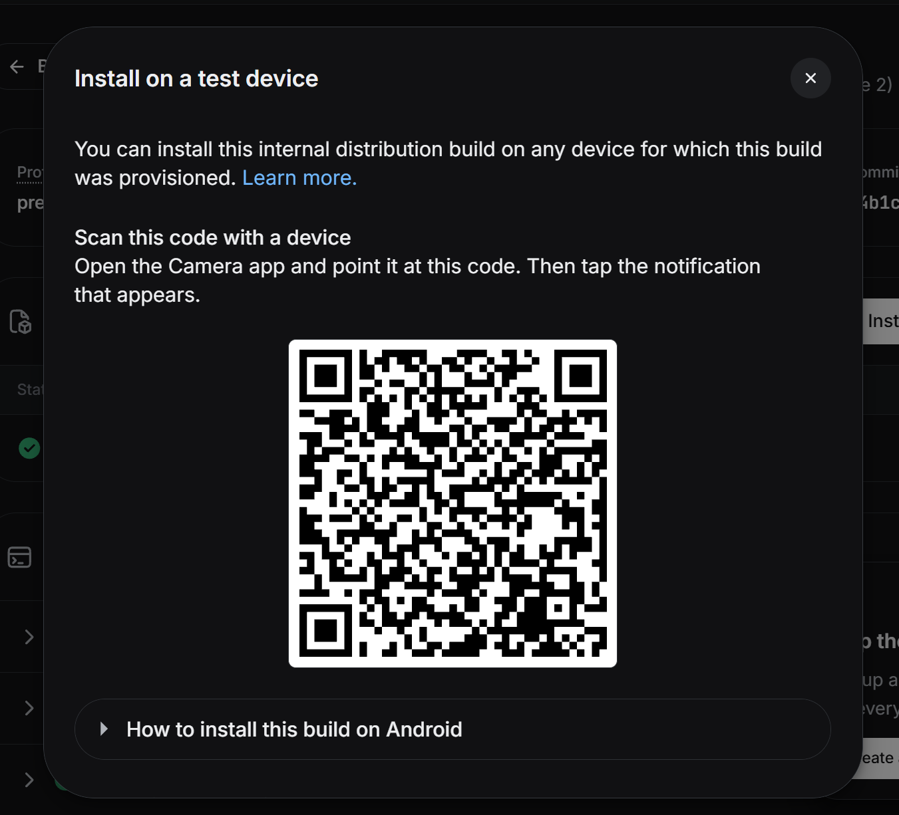

# Sistema de Consultas - Mobile

App React Native (Expo) para login de médico e paciente e agendamento de consultas, integrado ao backend Spring Boot [backend-consultas](https://github.com/Sara-Barbosa-Silva/backend-consultas).

## Deploy

### Backend
Hospedado no Render: https://backend-consultas-sara.onrender.com

- GET /health → {"status":"UP"}
- GET /medicos → lista de médicos
- GET /pacientes → lista de pacientes

> O serviço dorme após 15 min de inatividade (free tier).
> A primeira requisição pode levar até 60 segundos.

---

### Frontend - APK Android

Build gerado com EAS Build (perfil `preview`).

- EAS projectId: `4473acbb-7de4-4153-acdc-517394b87f51`
- Build: https://expo.dev/accounts/sara.barosa_23/projects/sistema-consultas-mobile/builds/8e3e7a07-b466-4359-af3e-5a6cda114ec9

1. Escaneie o QR Code abaixo **ou** baixe pelo link do Expo.
2. Permita instalação de fontes desconhecidas apenas para o instalador.
3. Instale e abra o app.

### QR Code do build (Expo Dashboard / EAS)

> Este QR é o da página do build em expo.dev - não o do `npx expo start`.

### Vídeo de demonstração

https://github.com/user-attachments/assets/5aef9d4c-f297-4217-a7f5-9466e5fd4133

Se o player não carregar: [baixar o vídeo de demonstração](./docs/video-demonstracao.mp4)

Gravado no celular Android com o APK instalado e o backend no Render. O vídeo mostra:

- instalação do APK pelo QR Code do expo.dev
- cadastro de paciente e login por CPF
- agendamento de consulta (especialidade → médico → data e hora)
- consulta listada em "Minhas Consultas"
- login do médico por CRM e confirmação da consulta

### Credenciais de teste

| Perfil | Campo | Valor |
|---|---|---|
| Médico | CRM | 789456 |
| Paciente | CPF | 12345678901 |
